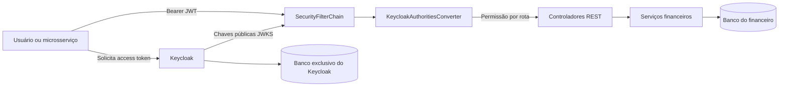
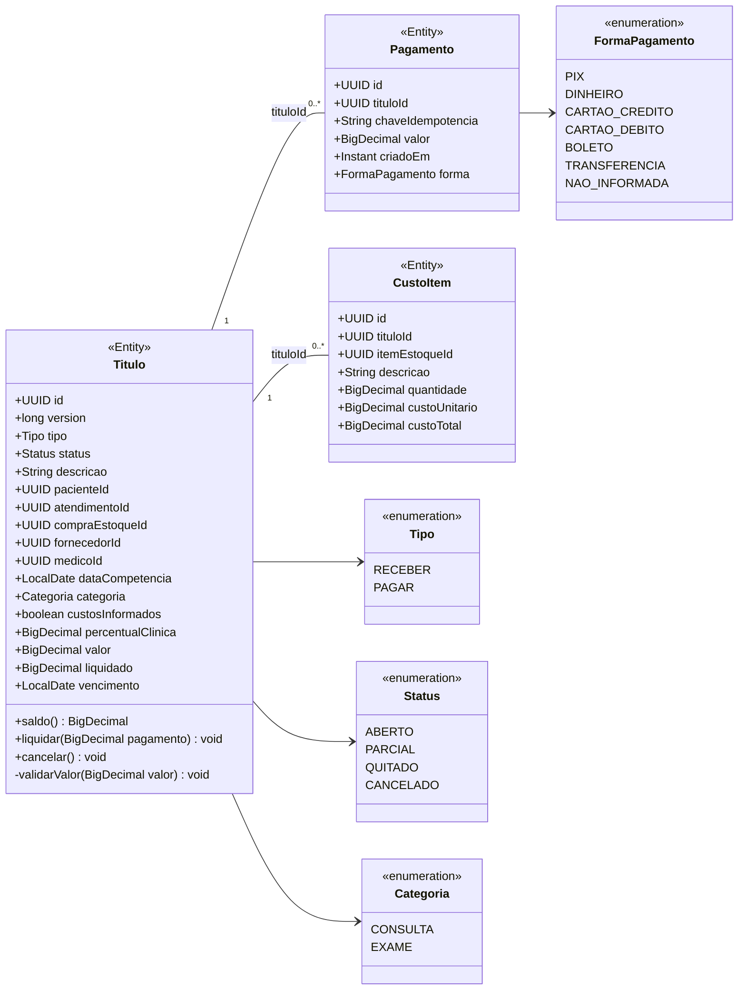
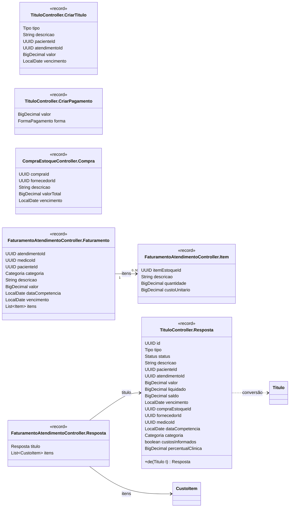
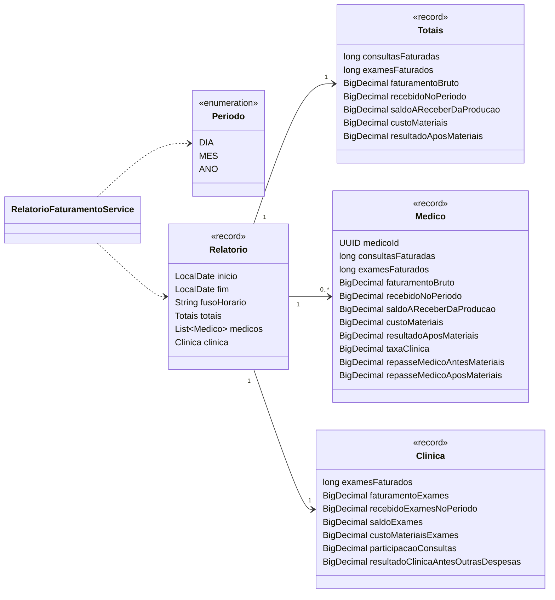

# Diagrama de classes — Financeiro da clínica

Retrato do código em `src/main/java/br/com/clinica/financeiro`, em 12/11/2026. As visões abaixo separam entidades, dependências e DTOs para facilitar a leitura. Construtores, anotações e métodos herdados do Spring foram omitidos.

## Segurança da API

Antes dos controladores, `SecurityConfig` configura uma `SecurityFilterChain` sem sessão, com autenticação OAuth2 Resource Server. O Keycloak emite os JWTs; o Spring Security verifica assinatura, validade, emissor e audiência. `KeycloakAuthoritiesConverter` converte somente as roles do cliente `financeiro-api` em permissões da API.

As integrações de estoque e atendimento têm roles distintas. Os perfis de leitura, operação e administração acessam dados financeiros conforme a tabela no README. A autorização atual não restringe dados por médico ou paciente.

## Entidades e enumerações

As associações Titulo–Pagamento e Titulo–CustoItem representam vínculos por UUID, garantidos pelas chaves estrangeiras das migrações. Não existem coleções de pagamentos/custos em Titulo nem mapeamentos JPA `@OneToMany` ou `@ManyToOne`.

`Tipo`, `Status` e `Categoria` são enumerações internas de `Titulo`. `FormaPagamento` é um tipo separado. Médico, paciente, fornecedor, atendimento, compra e item de estoque são referências externas; não existem classes de entidade para eles neste microsserviço.

## Controladores, serviços e persistência

As setas tracejadas representam dependências de uso. As interfaces de repositório estendem `JpaRepository`; o relatório usa SQL por `NamedParameterJdbcTemplate`, diretamente sobre as tabelas.

```mermaid
classDiagram
direction TB
class FinanceiroApplication {
  +main(String[] args) void
}
class TituloController {
  +criar(CriarTitulo r) ResponseEntity
  +buscar(UUID id) Resposta
  +listar(int page, int size) Page
  +pagar(UUID id, String chave, CriarPagamento r) Pagamento
  +cancelar(UUID id) ResponseEntity
}
class CompraEstoqueController {
  +registrar(Compra compra) Resposta
}
class PagamentoController {
  +listar(UUID id, int page, int size) Page
}
class CustoAtendimentoController {
  +listar(UUID id) List
}
class FaturamentoAtendimentoController {
  +registrar(Faturamento request) Resposta
}
class RelatorioFaturamentoController {
  +consultar(Periodo periodo, LocalDate referencia, UUID medicoId) Relatorio
}
class FinanceiroService {
  +criar(Titulo titulo) Titulo
  +registrarCompra(UUID compraId, UUID fornecedorId, String descricao, BigDecimal valor, LocalDate vencimento) Titulo
  +buscar(UUID id) Titulo
  +pagar(UUID id, String chave, BigDecimal valor, FormaPagamento forma) Pagamento
  +cancelar(UUID id) void
}
class FaturamentoAtendimentoService {
  +registrar(Faturamento r) Resposta
}
class RelatorioFaturamentoService {
  +totalizar(List medicos) Totais
  +intervalo(Periodo periodo, LocalDate referencia, LocalDate hoje) LocalDate[]
  +consultar(Periodo periodo, LocalDate referencia, UUID medicoId) Relatorio
}
class TituloRepository {
  <<interface>>
  +findByCompraEstoqueId(UUID compraEstoqueId) Optional
  +findByAtendimentoIdAndCategoriaIsNotNull(UUID atendimentoId) Optional
}
class PagamentoRepository {
  <<interface>>
  +findByChaveIdempotencia(String chave) Optional
  +findByTituloId(UUID tituloId, Pageable pageable) Page
}
class CustoItemRepository {
  <<interface>>
  +findByTituloIdOrderByItemEstoqueId(UUID tituloId) List
}
class JpaRepository {
  <<framework interface>>
}
class NamedParameterJdbcTemplate {
  <<framework>>
}
class ApiExceptionHandler {
  ~ausente(NoSuchElementException e) ProblemDetail
  ~invalido(Exception e) ProblemDetail
  ~conflito(IllegalStateException e) ProblemDetail
  ~concorrencia(Exception e) ProblemDetail
}
class ResponseEntityExceptionHandler {
  <<framework>>
}
TituloController ..> FinanceiroService
TituloController ..> TituloRepository
CompraEstoqueController ..> FinanceiroService
PagamentoController ..> FinanceiroService
PagamentoController ..> PagamentoRepository
CustoAtendimentoController ..> FinanceiroService
CustoAtendimentoController ..> CustoItemRepository
FaturamentoAtendimentoController ..> FaturamentoAtendimentoService
RelatorioFaturamentoController ..> RelatorioFaturamentoService
FinanceiroService ..> TituloRepository
FinanceiroService ..> PagamentoRepository
FinanceiroService ..> Titulo
FinanceiroService ..> Pagamento
FaturamentoAtendimentoService ..> TituloRepository
FaturamentoAtendimentoService ..> CustoItemRepository
FaturamentoAtendimentoService ..> Titulo
FaturamentoAtendimentoService ..> CustoItem
FaturamentoAtendimentoService ..> FaturamentoAtendimentoController : records de entrada e saída
RelatorioFaturamentoService ..> NamedParameterJdbcTemplate
JpaRepository <|-- TituloRepository
JpaRepository <|-- PagamentoRepository
JpaRepository <|-- CustoItemRepository
TituloRepository ..> Titulo
PagamentoRepository ..> Pagamento
CustoItemRepository ..> CustoItem
ResponseEntityExceptionHandler <|-- ApiExceptionHandler
```

`FinanceiroApplication` inicializa a aplicação e o escaneamento de componentes. O tratamento de erros é transversal por `@RestControllerAdvice`. As entidades do diagrama anterior são os mesmos tipos referenciados nesta visão.

## Records da API

Os identificadores abaixo distinguem records com o mesmo nome. Os rótulos correspondem aos tipos aninhados reais; os atributos são os componentes dos records, com acessores públicos gerados pelo Java.

## Records do relatório

Todos os tipos desta visão são internos de `RelatorioFaturamentoService`. `Medico` e `Clinica` são projeções do relatório, não entidades nem cadastros persistidos.

Regras refletidas no modelo:

- CONSULTA exige médico, retém 30% do bruto para a clínica e desconta os materiais da consulta da parte do médico.
- EXAME próprio não possui médico; receita e materiais pertencem à clínica.
- PAGAR é gerado por compra do estoque; RECEBER pode representar faturamento de atendimento.
- Pagamento armazena cada valor e forma individualmente; um título pode ter vários pagamentos parciais.
- Os custos mantêm quantidade, custo unitário histórico e total por item.
- Faturamento é apurado pela competência; recebimentos são apurados pela data dos pagamentos.
